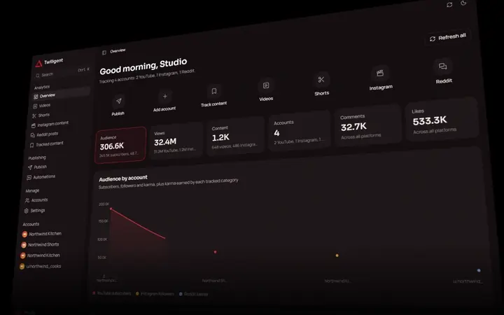
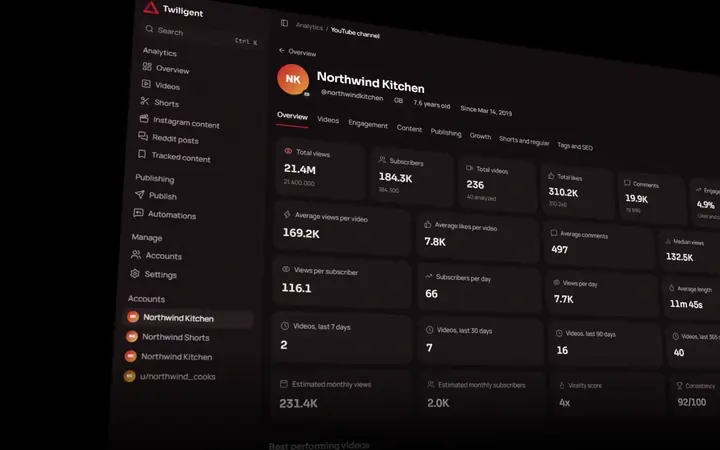
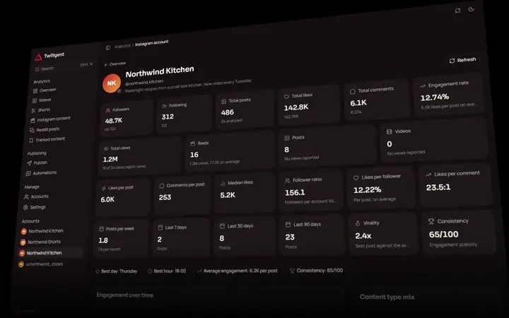
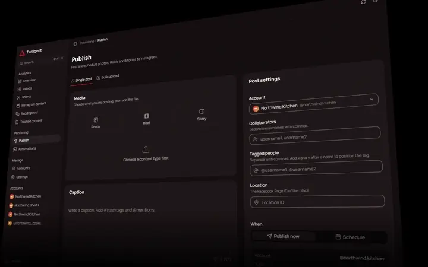
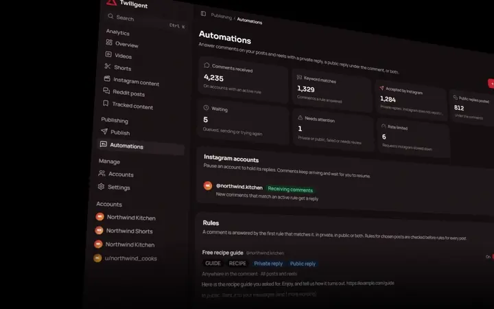
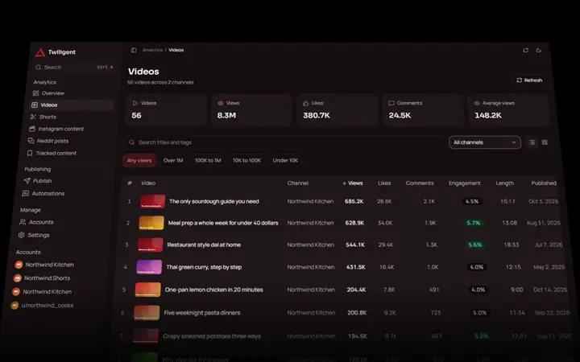
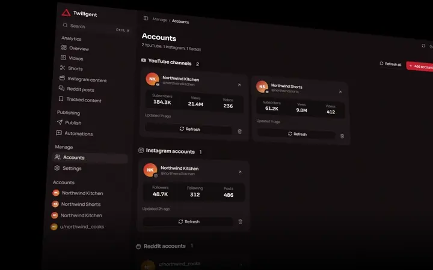
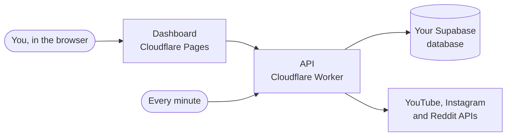

<div align="center">

<picture>
  <source media="(prefers-color-scheme: dark)" srcset="frontend/public/Logos/twiligent-lockup-stacked-reversed.svg" />
  
</picture>

<h3>Every channel, folded into one clear picture.</h3>

<p>A self-hosted dashboard for your YouTube, Instagram and Reddit numbers.<br/>
Publish to Instagram, schedule posts, and answer comments automatically.<br/>
It runs on accounts you own, mostly on free plans.</p>

<p>
  <a href="https://twiligent.ujjwal.fyi/docs"><b>Documentation</b></a> &nbsp;·&nbsp;
  <a href="https://app.twiligent.ujjwal.fyi"><b>Try it</b></a> &nbsp;·&nbsp;
  <a href="https://twiligent.ujjwal.fyi/docs/self-host"><b>Run your own</b></a> &nbsp;·&nbsp;
  <a href="https://github.com/spacesdrive/twiligent/issues"><b>Report an issue</b></a>
</p>

<p>
  <a href="https://github.com/spacesdrive/twiligent/actions/workflows/ci.yml"></a>
  <a href="https://github.com/spacesdrive/twiligent/releases"></a>
  <a href="LICENSE"></a>
  <a href="https://github.com/spacesdrive/twiligent"></a>
</p>

<br/>



</div>

<br/>

## Why Twiligent

If you post in more than one place, your numbers live in more than one place. YouTube Studio has some of them, Instagram has others, and Reddit keeps its own. Most tools that bring them together charge a monthly fee and ask for access to your accounts.

Twiligent puts them in one dashboard that you host yourself. Your data stays in your own database, your keys stay on your own server, and it runs mostly on free plans.

## What you can do

<table>
  <tr>
    <td width="50%" valign="top">
      
      <h4>See each channel in depth</h4>
      <p>Views, subscribers, engagement and growth for every YouTube channel, with Shorts and long videos compared and your best videos ranked.</p>
    </td>
    <td width="50%" valign="top">
      
      <h4>Know what works on Instagram</h4>
      <p>Followers, engagement rate, the best day and hour to post, and how Reels, photos and videos compare.</p>
    </td>
  </tr>
  <tr>
    <td width="50%" valign="top">
      
      <h4>Publish now, or at the hour you pick</h4>
      <p>Post photos, Reels and Stories to Instagram, or schedule them. The server publishes within 15 minutes of that time, even with your browser closed.</p>
    </td>
    <td width="50%" valign="top">
      
      <h4>Answer comments automatically</h4>
      <p>When someone comments a keyword such as GUIDE, they get your private reply and link within seconds, a public reply under their comment, or both.</p>
    </td>
  </tr>
  <tr>
    <td width="50%" valign="top">
      
      <h4>Find any video or post</h4>
      <p>Search and sort every video, Short, Reel and post across your accounts, by views, likes, comments or engagement.</p>
    </td>
    <td width="50%" valign="top">
      
      <h4>Bring every account together</h4>
      <p>Add YouTube channels by link or handle and Reddit profiles by username, connect Instagram with one sign-in, and refresh them all at once.</p>
    </td>
  </tr>
</table>

<sub>The recordings use a made-up brand, Northwind Kitchen. No real account data is shown.</sub>

## How it works

Twiligent is two small apps: the dashboard in your browser and an API on Cloudflare's network. The API reads your stats from each platform's official API, keeps your accounts in your own Supabase database, and runs the scheduled work.



The Worker wakes up on a timer, so scheduled posts go out and comment replies are sent without anyone keeping a tab open. Read more in [How scheduling works](https://twiligent.ujjwal.fyi/docs/reference/scheduling).

## Get started

You can use Twiligent in two ways.

### Use an existing instance

If someone gave you a link to their Twiligent, sign in there. There is nothing to install. Start with [Sign in and first steps](https://twiligent.ujjwal.fyi/docs/use/getting-started).

### Run your own

You need a free Cloudflare account, a free Supabase project and the API keys for the platforms you want. The [self-hosting guide](https://twiligent.ujjwal.fyi/docs/self-host) walks through every key, step by step.

To try it on your own machine first, you need Node.js 22.18 or newer:

```bash
git clone https://github.com/spacesdrive/twiligent.git
cd twiligent
npm install
npm run dev
```

The dashboard opens at `http://localhost:5173`. It needs a few keys in `backend/.dev.vars` before it can load data; [Environment variables](https://twiligent.ujjwal.fyi/docs/reference/environment) lists each one.

## Documentation

Everything else lives in the docs at [twiligent.ujjwal.fyi/docs](https://twiligent.ujjwal.fyi/docs).

| If you want to | Read |
|---|---|
| Learn the basics | [Introduction](https://twiligent.ujjwal.fyi/docs) and [Members and administrators](https://twiligent.ujjwal.fyi/docs/concepts) |
| Add your channels and accounts | [Connect your accounts](https://twiligent.ujjwal.fyi/docs/use/connect-accounts) |
| Understand the numbers | [Read your analytics](https://twiligent.ujjwal.fyi/docs/use/analytics) |
| Post and schedule to Instagram | [Publish and schedule](https://twiligent.ujjwal.fyi/docs/use/publishing) |
| Reply to comments automatically | [Reply to comments automatically](https://twiligent.ujjwal.fyi/docs/use/automations) |
| Host your own copy | [Self-hosting overview](https://twiligent.ujjwal.fyi/docs/self-host) and the [Launch checklist](https://twiligent.ujjwal.fyi/docs/self-host/checklist) |
| Fix a problem | [Troubleshooting](https://twiligent.ujjwal.fyi/docs/use/troubleshooting) and the [FAQ](https://twiligent.ujjwal.fyi/docs/reference/faq) |
| Know how your data is kept safe | [Security](https://twiligent.ujjwal.fyi/docs/reference/security) |

## Contributing

Contributions are welcome. Every change starts with an issue, so look through the [open issues](https://github.com/spacesdrive/twiligent/issues) first, or open a new one to describe what you have in mind. Then fork the repository, make your change on a branch, and open a pull request that names the issue.

The engineering docs in [`docs/`](docs) explain how the code is organized. Start with [CLAUDE.md](CLAUDE.md): it maps the project and links to the coding and writing standards.

## License

Twiligent is open source under the [MIT license](LICENSE). Work by others that the project includes is credited in [THIRD_PARTY_NOTICES.md](THIRD_PARTY_NOTICES.md).

<br/>

<div align="center">
  <sub>Built by <a href="https://github.com/spacesdrive">spacesdrive</a>. If Twiligent helps you, a star helps others find it.</sub>
</div>
