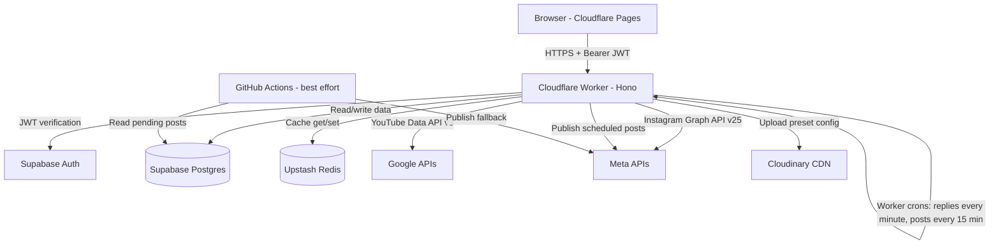

<div align="center">

  

  <h1>Twiligent</h1>

  <p><strong>A self-hosted analytics and publishing dashboard for YouTube and Instagram.<br/>Your data. Your infrastructure. No subscriptions.</strong></p>

  <p>
    <a href="https://www.typescriptlang.org"></a>
    <a href="https://react.dev"></a>
    <a href="https://vitejs.dev"></a>
    <a href="https://tailwindcss.com"></a>
    <a href="https://hono.dev"></a>
    <a href="https://workers.cloudflare.com"></a>
    <a href="LICENSE"></a>
  </p>

  <br/>

  

  <br/>
  <sub>Dashboard overview tracking YouTube and Instagram accounts side by side</sub>

</div>

---

## What is Twiligent?

Every analytics product wants a monthly subscription and access to your data. Twiligent is the alternative: a self-hosted dashboard that pulls your YouTube and Instagram stats directly from their official APIs, displays them in one place, and runs entirely on infrastructure you control.

You deploy one Cloudflare Worker and one Cloudflare Pages site using your own API credentials. Your data is stored in your own Supabase database and cached in your own Upstash Redis instance. No shared infrastructure. No accounts created on third-party services beyond the free tiers you choose. No ongoing cost.

The project's own public site and documentation are at [twiligent.ujjwal.fyi](https://twiligent.ujjwal.fyi), and its own instance of the app runs at [app.twiligent.ujjwal.fyi](https://app.twiligent.ujjwal.fyi). The site is built from the `site/` folder of this repository; you do not need to deploy it to run your own Twiligent.

---

## Table of Contents

- [Features](#features)
- [Screenshots](#screenshots)
- [Quick Start](#quick-start)
- [Prerequisites](#prerequisites)
- [Installation](#installation)
- [Development](#development)
- [Configuration](#configuration)
- [Scheduled Publishing with GitHub Actions](#scheduled-publishing-with-github-actions)
- [How It Works](#how-it-works)
- [Project Structure](#project-structure)
- [Tech Stack](#tech-stack)
- [Contributing](#contributing)
- [License](#license)

---

## Features

| Feature | Details |
|---|---|
| **Multi-account support** | Add unlimited YouTube channels and Instagram Business or Creator accounts |
| **YouTube analytics** | Views, subscribers, likes, comments, engagement rate, avg views per video, Shorts vs. long-form breakdown, top videos, Tags and SEO analysis |
| **Instagram analytics** | Followers, engagement rate, virality score, consistency score, best posting day and hour, content-type performance, hashtag analysis, caption-length correlation |
| **Unified overview** | Cross-platform totals, audience comparison chart, audience share pie, leaderboards |
| **Content explorers** | Sortable and filterable grids for all YouTube Videos, all YouTube Shorts, and all Instagram Reels and posts |
| **Scheduled publishing** | Schedule Instagram photos, Reels, and Stories; a Cloudflare Worker cron publishes them every 15 minutes automatically |
| **Comment-to-DM automation** | When someone comments a keyword such as GUIDE, or any comment at all, on your Instagram posts or Reels, Twiligent sends them your private reply and link within seconds, through Meta's comments webhook and official private replies; optional followers-only rules send the link only after Instagram confirms the person follows you; per-account, per-rule and per-person limits, retries, a queue that sends waiting replies every minute and an activity log |
| **Bulk upload** | Upload multiple files at once, assign captions individually or apply a shared caption, schedule them with configurable intervals |
| **Cloudinary CDN** | Upload media directly from the dashboard; Instagram requires public URLs before publishing |
| **Token auto-refresh** | Instagram long-lived tokens renew automatically every 24 hours via a daily Worker cron so analytics never break |
| **Authentication** | Supabase Auth: Google, a 6-digit code emailed to the address (which also creates the account), or email and password; codes sent through Resend with a daily cap; each user's accounts and posts are fully isolated |
| **Dark and light mode** | Toggle between themes from the header |

---

## Screenshots

<table width="100%">
  <tr>
    <td width="50%" align="center">
      
      <br/><sub><strong>YouTube Channel Analytics</strong> - 20+ metrics across 8 tabs including Overview, Videos, Engagement, Content, Publishing, Growth, Shorts vs Regular, and Tags and SEO</sub>
    </td>
    <td width="50%" align="center">
      
      <br/><sub><strong>Instagram Account Analytics</strong> - follower stats, engagement timeline, best posting times, consistency score, and virality score</sub>
    </td>
  </tr>
</table>

<br/>

<table width="100%">
  <tr>
    <td width="33%" align="center">
      
      <br/><sub><strong>Video Explorer</strong> - browse, search, and sort all YouTube videos with thumbnail previews and per-video stats</sub>
    </td>
    <td width="33%" align="center">
      
      <br/><sub><strong>Shorts Explorer</strong> - dedicated grid view for YouTube Shorts with performance filtering</sub>
    </td>
    <td width="33%" align="center">
      
      <br/><sub><strong>IG Content Explorer</strong> - browse all reels, photos, and carousels sorted by likes, comments, or engagement</sub>
    </td>
  </tr>
</table>

<br/>

<table width="100%">
  <tr>
    <td width="33%" align="center">
      
      <br/><sub><strong>Accounts</strong> - add and remove YouTube channels and Instagram accounts; view live stats at a glance</sub>
    </td>
    <td width="33%" align="center">
      
      <br/><sub><strong>Publish</strong> - upload to Cloudinary, schedule or publish immediately, single or bulk mode</sub>
    </td>
    <td width="33%" align="center">
      
      <br/><sub><strong>Settings</strong> - theme, server status, and setup guides for scheduled publishing and Instagram access</sub>
    </td>
  </tr>
</table>

---

## Quick Start

Clone and install dependencies (one install at the root covers the backend, the frontend and the public site):

```bash
git clone https://github.com/spacesdrive/twiligent.git
cd twiligent
npm install
```

Create `backend/.dev.vars` with your credentials (see [Configuration](#configuration)), then start both servers from the root:

```bash
npm run dev
```

This runs the backend Worker on port 8787 and the frontend on port 5173 in one terminal.

Open [http://localhost:5173](http://localhost:5173) and sign up for an account, then go to **Accounts** to add your first YouTube channel or Instagram account.

The full documentation, including a step-by-step self-hosting guide that explains every key, is at [twiligent.ujjwal.fyi/docs](https://twiligent.ujjwal.fyi/docs). It is public, so you can share the link with members before they sign in. The pages are MDX files in `site/content/docs/`; run `npm run dev:site` to preview the site and docs locally.

**Using someone else's Twiligent?** You need none of this. Sign in with the link you were given; the server, keys and scheduled publishing are already handled by the administrator.

---

## Prerequisites

| Requirement | Notes |
|---|---|
| Node.js 22.18 or later | Node runs the TypeScript tests and the scheduled publisher directly by stripping types, which needs 22.18 or newer (the `engines` field in `package.json`); the GitHub workflows use Node 24 |
| Wrangler CLI | Installed by `npm install` at the root; run `npx wrangler login` once |
| Cloudflare account | Free tier sufficient for Workers and Pages |
| Supabase project | Free tier sufficient; create at [supabase.com](https://supabase.com) |
| YouTube Data API v3 key | Required for YouTube analytics |
| Instagram Graph API | Meta app of type Business required |
| Cloudinary account | Required for content publishing only |

---

## Installation

**1. Clone the repository**

```bash
git clone https://github.com/spacesdrive/twiligent.git
cd twiligent
```

**2. Install dependencies**

```bash
npm install
```

The repository is an npm workspaces monorepo: `backend/`, `frontend/` and `site/` (the public marketing site and docs) are workspaces, and one install at the root fills a single `node_modules` from the single root `package-lock.json`. Do not run `npm install` inside `backend/`, `frontend/` or `site/`.

**3. Create the Supabase database tables**

The schema is versioned in `supabase/migrations/` and applied with the Supabase CLI, which `npm install` installed. Link the CLI to your project once, then apply every migration:

```bash
npx supabase login                            # or set SUPABASE_ACCESS_TOKEN
npx supabase link --project-ref <project-ref> # the id in your project's dashboard URL
npm run db:check                              # lists the migrations it will apply
npm run db:push                               # applies them
```

This creates the four tables Twiligent uses and closes them to the browser: row level security is on with no policies, and the roles behind the public publishable key have no grants. It also adds the value checks, the keys that tie posts to their owner's accounts, the `updated_at` triggers, the functions that merge row data in one statement, and the indexes. `npm run db:status` lists which migrations are applied.

An instance created from an earlier version of this README, including one that ran the `claimed_at` and `attempts` upgrade SQL, runs the same commands before deploying this version. The first four migrations are baselines that are safe on existing tables and bring every earlier setup to the same schema. If a value check stops the push because of an old row, the error names the constraint; fix the row and run `npm run db:push` again.

If you cannot use the CLI, open the SQL editor and run each file from `supabase/migrations/` in file name order, then apply later files the same way, since the CLI will not know they ran.

Then, in Supabase Authentication, turn off **Confirm email** unless you have set up email verification codes ([docs](https://twiligent.ujjwal.fyi/docs/self-host/email-codes)), and turn off new signups once your team has accounts if the instance is private. The sign-in page's email field sends a sign-in code; without the email codes setup, Supabase sends its own rate-limited Magic Link email, which holds a link (add `{{ .Token }}` to its template in Authentication, Emails to show the code too).

**4. Configure credentials**

See [Configuration](#configuration) below.

**5. Start the development servers**

```bash
npm run dev
```

The backend runs on port 8787. The frontend runs on port 5173. Open [http://localhost:5173](http://localhost:5173). To run one side alone, use `npm run dev:backend` or `npm run dev:frontend`.

---

## Development

Run every command from the repository root.

| Command | What it does |
|---|---|
| `npm install` | Installs every workspace and the shared tooling |
| `npm run dev` | Starts the Worker (`wrangler dev`, port 8787) and Vite (port 5173) together |
| `npm run dev:backend` / `npm run dev:frontend` | Starts one of them |
| `npm run dev:site` | Starts the public site and docs (`site/`) on its own Vite dev server |
| `npm run typecheck` | Type-checks every TypeScript project: backend, backend tests, frontend, frontend tooling and tests, site, site build files and tests, scripts |
| `npm run build` | Builds the frontend into `frontend/dist/`, then the site into `site/dist/` |
| `npm test` | Runs the backend, frontend and site tests (Node's built-in test runner on `tests/**/*.test.ts`) |
| `npm run lint` | Runs ESLint over the whole repository with the shared `eslint.config.mjs` |
| `npm run format` | Applies Prettier (`.prettierrc.json`) to the whole repository |
| `npm run db:new <name>` | Creates a migration file in `supabase/migrations/` (`supabase migration new`) |
| `npm run db:status` | Lists the migrations and whether each is applied to the linked project (`supabase migration list`) |
| `npm run db:check` | Shows what `db:push` would apply, without applying it (`supabase db push --dry-run`) |
| `npm run db:push` | Applies pending migrations to the linked project (`supabase db push`) |

Add a dependency to the workspace that uses it: `npm install <package> --workspace backend`, `--workspace frontend` or `--workspace site`. Only shared development tooling goes in the root `package.json`.

The whole project is TypeScript in `strict` mode. Nothing is compiled ahead of time: Wrangler and Vite strip the types while bundling, and Node strips them when it runs the tests and `scripts/publish-scheduled.ts`. None of them checks types, so run `npm run typecheck` before you commit; CI runs it on every pull request and before every deploy. The API request and response types live once in `shared/types/` and are used by both the backend and the frontend. See `docs/guidelines/TYPESCRIPT.md`.

Tests live outside the source folders, in `backend/tests/`, `frontend/tests/` and `site/tests/`, and mirror the source tree: the test for `backend/services/youtube/youtubeChannels.ts` is `backend/tests/services/youtube/youtubeChannels.test.ts`, and the test for `frontend/src/lib/accounts.ts` is `frontend/tests/lib/accounts.test.ts`. Backend fixtures and golden snapshots are in `backend/tests/fixtures/`.

Database changes are migrations: `npm run db:new <name>` creates the file, its reverse goes in `supabase/rollbacks/` with the same name, and `npm run db:push` applies it before the code that needs it is merged. See `docs/features/NEW_DATABASE_TABLE.md` and `docs/workflows/DEPLOYMENT.md`.

ESLint (with `typescript-eslint`), Prettier and EditorConfig are configured once at the root, and the shared compiler settings are in `tsconfig.base.json`. The existing code has not been reformatted in bulk, so run `npm run format` only when you mean to reformat.

---

## Configuration

### Local development (`backend/.dev.vars`)

Create `backend/.dev.vars` (this file is gitignored):

```
SUPABASE_URL=https://your-project.supabase.co
SUPABASE_SERVICE_KEY=eyJhbGciOiJIUzI1NiIsInR5cCI6IkpXVCJ9...
SUPABASE_ANON_KEY=eyJhbGciOiJIUzI1NiIsInR5cCI6IkpXVCJ9...
YOUTUBE_API_KEY=AIzaSy...
INSTAGRAM_APP_ID=123456789
INSTAGRAM_APP_SECRET=abc123...
CLOUDINARY_CLOUD_NAME=mycloud
CLOUDINARY_UPLOAD_PRESET=ml_default
BACKEND_URL=http://localhost:8787
FRONTEND_URL=http://localhost:5173
UPSTASH_REDIS_REST_URL=https://...
UPSTASH_REDIS_REST_TOKEN=...
```

`UPSTASH_REDIS_REST_URL` and `UPSTASH_REDIS_REST_TOKEN` are optional. The app works without Redis - analytics are fetched live on every request with caching disabled.

`FRONTEND_URL` is also the only browser origin the API accepts. To serve the app from more than one address, list the others in the optional `ALLOWED_ORIGINS` (comma-separated, for example `ALLOWED_ORIGINS=https://twiligent.pages.dev`). A Worker running on `localhost` also accepts the Vite dev server on port 5173.

### Frontend environment variables (`frontend/.env.local`)

```
VITE_SUPABASE_URL=https://your-project.supabase.co
VITE_SUPABASE_ANON_KEY=eyJhbGciOiJIUzI1NiIsInR5cCI6IkpXVCJ9...
VITE_API_URL=http://localhost:8787/api
# Optional: who users contact for Instagram tester access and scheduling problems
VITE_ADMIN_EMAIL=you@example.com
# Optional: Google web client ID; shows Continue with Google (see https://twiligent.ujjwal.fyi/docs/self-host/google-sign-in)
VITE_GOOGLE_CLIENT_ID=1234567890-abc.apps.googleusercontent.com
```

### Production (Cloudflare Workers secrets)

Set each secret via Wrangler, from the `backend/` folder:

```bash
npx wrangler secret put SUPABASE_URL
npx wrangler secret put SUPABASE_SERVICE_KEY
npx wrangler secret put SUPABASE_ANON_KEY
npx wrangler secret put YOUTUBE_API_KEY
npx wrangler secret put INSTAGRAM_APP_ID
npx wrangler secret put INSTAGRAM_APP_SECRET
npx wrangler secret put CLOUDINARY_CLOUD_NAME
npx wrangler secret put CLOUDINARY_UPLOAD_PRESET
npx wrangler secret put BACKEND_URL
npx wrangler secret put FRONTEND_URL
npx wrangler secret put ALLOWED_ORIGINS             # optional
npx wrangler secret put UPSTASH_REDIS_REST_URL      # optional
npx wrangler secret put UPSTASH_REDIS_REST_TOKEN    # optional
npx wrangler secret put SEND_EMAIL_HOOK_SECRET      # optional; email verification codes
npx wrangler secret put RESEND_API_KEY              # optional
npx wrangler secret put EMAIL_FROM                  # optional
npx wrangler secret put EMAIL_DAILY_LIMIT           # optional; defaults to 100
npx wrangler secret put INSTAGRAM_WEBHOOK_VERIFY_TOKEN  # optional; comment-to-DM automation
npx wrangler secret put META_APP_SECRET             # optional; a second key for webhook signatures
```

Comment-to-DM automation needs `INSTAGRAM_WEBHOOK_VERIFY_TOKEN`, the webhook added in the Meta dashboard (`https://<worker>/api/webhooks/instagram`, field `comments`, plus `messages` only for followers-only rules) and, for comments from people without a role on your app, a Live app with Advanced Access. Optional `AUTOMATION_*` settings change the reply limits or pause every reply. Setup steps are in the [docs](https://twiligent.ujjwal.fyi/docs/self-host/comment-automation).

The four email secrets turn on the 6-digit codes that sign people in and confirm password sign-ups, sent free through Resend (100 a day). Supabase Auth hands each email to the Worker through its Send Email hook (`POST /api/auth/email-hook`); every code sign-in is one email. Past the daily limit, the sign-in page pauses email codes and points people to Google or their password. Setup steps are in the [docs](https://twiligent.ujjwal.fyi/docs/self-host/email-codes).

### Getting API credentials

**YouTube Data API v3**

1. Open [Google Cloud Console](https://console.cloud.google.com/) and create a new project
2. Navigate to **APIs and Services** then **Library**, search for "YouTube Data API v3", and enable it
3. Go to **Credentials**, click **Create Credentials**, and select **API key**
4. Optionally restrict the key to the YouTube Data API v3 for security
5. Set it as `YOUTUBE_API_KEY`

**Instagram Graph API**

Instagram requires a Business or Creator account linked to a Facebook Page.

1. Go to [Meta for Developers](https://developers.facebook.com/) and create an app of type **Business**
2. Add the **Instagram Graph API** product to your app
3. Note your **App ID** and **App Secret** from the app's Basic Settings
4. Set `INSTAGRAM_APP_ID` and `INSTAGRAM_APP_SECRET`
5. In Twiligent, go to **Accounts** and use the **Connect Instagram** flow to authorize accounts via OAuth

**Cloudinary (required for publishing only)**

1. Sign up at [cloudinary.com](https://cloudinary.com) (free tier: 25 GB storage, 25 GB bandwidth per month)
2. From the Cloudinary dashboard, copy your **Cloud name**
3. Create an **unsigned upload preset** in Cloudinary (Settings then Upload then Upload presets)
4. Set `CLOUDINARY_CLOUD_NAME` and `CLOUDINARY_UPLOAD_PRESET`

---

## Scheduled Publishing with GitHub Actions

Twiligent uses a dual-scheduler approach to publish Instagram posts reliably:

1. **Primary:** The Cloudflare Worker has a built-in cron trigger that fires every 15 minutes. No setup required - it runs automatically once the Worker is deployed.
2. **Fallback:** A GitHub Actions workflow (`publish-scheduled.yml`) asks for a run every 15 minutes, at minutes 7, 22, 37 and 52. GitHub starts scheduled runs when it has capacity, often hours late and sometimes not at all, so this catches posts the Worker missed later, not within 15 minutes.

Both schedulers write to the same `scheduled_posts` table in Supabase. A run claims a post before publishing it, so the same post is never published twice, and a claim older than 20 minutes is taken over by the next run, so a run that stopped halfway does not leave the post stuck.

### How scheduling works

1. You schedule a post through the **Publish** page (photo, reel, or story with caption and optional metadata)
2. The post is saved to Supabase with `status: 'pending'` and a `scheduled_at` timestamp
3. The Worker cron fires every 15 minutes, queries for due posts, and publishes them via the Instagram Graph API
4. Each post is marked `publishing` before the API call and `published` or `failed` after. The Instagram container id is saved before publishing, so a later run can check whether the post already went out before trying again
5. A passing problem, such as a timeout or a temporary Instagram error, sends the post back to `pending` for the next run, up to 3 attempts
6. The GitHub Actions workflow runs the same logic as a redundant fallback

### Setup (GitHub Actions fallback only)

The Cloudflare Worker cron requires no additional setup. The GitHub Actions fallback takes about 5 minutes:

1. **Fork** this repository to your GitHub account.
2. **Copy two values from Supabase:** the project URL (Integrations, Data API) and a secret key (Settings, API Keys; `sb_secret_...`, or the legacy `service_role` key).
3. **Add them as repository secrets** named `SUPABASE_URL` and `SUPABASE_SERVICE_KEY` (Settings, Secrets and variables, Actions).
4. **Switch on the workflow** in the Actions tab, including **Instagram Scheduled Publisher**.
5. **Run it once** with Run workflow and check for a green tick.

Full walkthrough with what to expect at each step and fixes for common errors: [docs/workflows/SCHEDULING_SETUP.md](docs/workflows/SCHEDULING_SETUP.md). The same guide is in the app under Settings, Scheduled publishing, with direct links once you enter your GitHub username.

---

## How It Works



**Request lifecycle:**

1. The browser sends a request with a Supabase JWT in the `Authorization: Bearer` header
2. The Cloudflare Worker checks the origin (CORS), gives the request an id, applies rate limits and verifies the JWT to get the user ID
3. A route table hands the request to a controller, which calls a service; the service reads and writes Supabase through repositories that filter by the verified user ID
4. Frequently accessed data (analytics) is read from Upstash Redis if available; otherwise fetched live from the platform APIs and cached
5. Responses are returned as JSON with an `X-Request-Id` header; access tokens are always stripped before leaving the Worker, and every failure has the same body: `{ success: false, code, message, requestId }`

**Cron lifecycle:**

1. The Worker has three cron triggers. Every minute (`* * * * *`) it sends the comment replies and follow-up messages that are waiting. Every 5 minutes (`*/5 * * * *`) it publishes due posts on the quarter hour (minutes 0, 15, 30 and 45); the other runs check the reply queue: they expire overdue replies, look for replies whose answer was lost and log the queue's health
2. On a publishing run the Worker queries `scheduled_posts` for rows with `status = 'pending'` and `scheduled_at <= now()`, and for `publishing` rows whose claim is older than 20 minutes
3. Each post is claimed (`publishing`, with `claimed_at` and `attempts`), published to Instagram, then set to `published`, back to `pending` for a retry, or `failed`
4. A daily `0 0 * * *` cron refreshes expiring Instagram access tokens across all users and deletes comment automation records past their retention, in batches

---

## Project Structure

```
twiligent/
├── .github/
│   └── workflows/
│       ├── ci.yml                   # Type check, lint, test, build and Worker dry-run on pull requests and branches
│       ├── deploy-backend.yml       # Type check, test, then Wrangler deploy on backend, shared or root config changes
│       ├── deploy-frontend.yml      # Type check, test, then Cloudflare Pages deploy on frontend, shared or root config changes
│       ├── deploy-site.yml          # Type check, test, then deploy the public site to the twiligent-site Pages project
│       └── publish-scheduled.yml    # Scheduled post fallback (asks for every 15 minutes, Node 24)
│
├── backend/
│   ├── app.ts                       # createApp(): the ordered middleware pipeline and route groups
│   ├── server.ts                    # Worker export (fetch + scheduled)
│   ├── container.ts                 # Composition root: builds repositories and services per request
│   ├── middleware/                  # cors, requestContext, securityHeaders, clients, rateLimit, auth, authHook, metaWebhook, validate, errorHandler
│   ├── routes/                      # One route table per feature (<feature>Routes.ts) and index.ts (public and protected)
│   ├── controllers/                 # HTTP only: read input, call one service method, build the response
│   ├── validators/                  # Request body and query parsers
│   ├── services/
│   │   ├── *Service.ts              # Feature services: business rules, no Hono types
│   │   ├── scheduledPublisher.ts    # Publishes due scheduled posts (cron and manual trigger)
│   │   ├── automationProcessor.ts   # Sends comment-to-DM replies within limits (webhook, retry and every minute cron)
│   │   ├── automationFollowupProcessor.ts # Checks the follow for followers-only replies and sends the link or a reminder
│   │   ├── automationReconciler.ts  # Expires overdue replies, checks lost replies on Instagram, logs queue health
│   │   ├── youtube/                 # YouTube Data API v3 client and analytics
│   │   ├── instagram/               # Instagram Graph API client, OAuth, publishing and analytics
│   │   └── reddit/                  # Reddit public JSON API client and analytics
│   ├── repositories/                # All Supabase queries and the Redis analytics cache
│   ├── database/                    # Supabase and Upstash Redis client factories
│   ├── jobs/
│   │   └── scheduled.ts             # Cron entry point: reply dispatch every minute, due posts on the quarter hour, queue checks every 5 minutes, token refresh and retention daily
│   ├── lib/
│   │   ├── errors.ts                # Typed errors; the error handler maps each code to a status
│   │   ├── ids.ts                   # newRowId(): random UUIDs for new rows
│   │   ├── logger.ts                # Structured JSON log lines
│   │   ├── config.ts                # Cleaned Worker settings and allowed CORS origins
│   │   ├── safeAccount.ts           # Strips tokens and cookies from accounts in responses
│   │   ├── oauthState.ts            # HMAC-signed Instagram OAuth state
│   │   ├── analyticsMath.ts         # Shared analytics formulas
│   │   ├── scheduledPublishing.ts   # Lease, retry and container rules shared with the GitHub Actions script
│   │   ├── automationMatching.ts    # Keyword and any-comment matching for comment automation rules
│   │   ├── automationRules.ts       # Rule checks: keywords for each mode, followers-only texts
│   │   ├── automationDelivery.ts    # What each Instagram answer means for a reply: retry, wait, stop or review
│   │   ├── automationReview.ts      # Finds a lost reply in the Instagram conversation
│   │   ├── automationHealth.ts      # Reply queue health and when it warrants a warning
│   │   ├── metaWebhookSignature.ts  # X-Hub-Signature-256 check for Meta's webhooks
│   │   └── rateLimit/               # Rate limit rules, algorithms and Lua scripts
│   ├── types/
│   │   ├── env.ts                   # Env: Worker secrets and bindings
│   │   ├── app.ts                   # AppEnv, AppContext: Hono context typing
│   │   └── context.ts               # RequestContext: request id, signal and logger for services
│   ├── tests/                       # Node tests (*.test.ts) mirroring lib/, middleware/, repositories/, routes/, services/, validators/; database/ checks the migration files; fixtures/ holds fakes and golden snapshots
│   ├── wrangler.toml                # Cloudflare Worker config (main = "server.ts") and cron triggers
│   ├── tsconfig.json                # Worker type check (Workers types, no DOM or Node)
│   └── package.json                 # Backend workspace: hono, supabase-js, upstash redis, wrangler, workers-types
│
├── frontend/
│   ├── tests/                       # Node tests (*.test.ts) mirroring src/ (lib, utils, features)
│   ├── index.html                   # Loads /src/main.tsx
│   ├── vite.config.ts               # Vite config: React and Tailwind plugins, @ alias
│   ├── tsconfig.json                # Type check for src/ (DOM, JSX, @/ and @shared/ paths)
│   ├── tsconfig.node.json           # Type check for vite.config.ts and tests/
│   ├── package.json                 # Frontend workspace: React, Vite, Tailwind, shadcn
│   └── src/
│       ├── main.tsx                 # Entry point
│       ├── App.tsx                  # Router and provider tree
│       ├── features/
│       │   ├── analytics/
│       │   │   ├── overview/        # Unified cross-platform dashboard
│       │   │   ├── channel/         # YouTube channel deep-dive (8 tabs)
│       │   │   ├── instagram/       # Instagram account analytics
│       │   │   ├── videos/          # All videos explorer
│       │   │   ├── shorts/          # YouTube Shorts explorer
│       │   │   └── reels/           # Instagram content explorer
│       │   ├── accounts/            # Account management UI
│       │   ├── publishing/          # Single and bulk upload with scheduler
│       │   ├── automations/         # Comment-to-DM rules, account controls and reply activity
│       │   └── settings/            # Theme, server status, setup guides
│       ├── context/
│       │   └── AppContext.tsx       # Global accounts and loading state
│       ├── layout/
│       │   ├── Sidebar.tsx          # Collapsible navigation sidebar
│       │   └── Header.tsx           # Breadcrumbs, refresh, theme toggle
│       ├── components/ui/           # shadcn/ui components and custom primitives
│       └── services/
│           └── api.ts               # Frontend API client (all fetch calls)
│
├── site/                            # Public marketing site and docs (twiligent.ujjwal.fyi); not needed to self-host
│   ├── content/docs/                # Docs pages in MDX, each starting with export const meta = { title, description }
│   ├── build/                       # Vite docs plugin (search index, sitemap.xml, llms.txt) and the icon generator
│   ├── public/                      # Fonts, brand assets, _redirects to the app, robots.txt
│   ├── src/                         # Pages, sections, mockups, the docs layout and search, nav.ts
│   ├── tests/                       # Node tests: docs navigation, metadata, links and search helpers
│   └── package.json                 # Site workspace: React, Vite, Tailwind, MDX, MiniSearch, motion
│
├── shared/
│   └── types/                       # API contract shared by backend and frontend (types only)
│
├── supabase/
│   ├── migrations/                  # Versioned schema changes, one table, access, trigger, index or function per file, applied with npm run db:push
│   ├── rollbacks/                   # The reverse of each migration, same file name, run by hand
│   └── config.toml                  # Supabase CLI config (Postgres 17)
│
├── scripts/
│   ├── publish-scheduled.ts         # TypeScript run directly by Node in the GitHub Actions fallback (no dependencies)
│   └── tsconfig.json                # Type check for scripts/ (Node types)
│
├── package.json                     # npm workspaces root: scripts, shared dev tooling, engines (Node 22.18+)
├── package-lock.json                # The only lockfile, for every workspace
├── tsconfig.base.json               # Shared strict compiler settings
├── eslint.config.mjs                # Shared ESLint config
├── .prettierrc.json                 # Shared Prettier config
└── .editorconfig                    # Shared editor defaults
```

---

## Tech Stack

**Language and tooling**

| Tool | Version | Purpose |
|---|---|---|
| TypeScript | 6.0 | Strict type checking across the backend, frontend, public site, shared types, scripts and tests |
| typescript-eslint | 8 | TypeScript lint rules |
| Node.js | 22.18 or later | Runs the tests and the scheduled publisher by stripping types |
| Supabase CLI (`supabase`) | 2 | Applies the database migrations (root dev dependency) |

**Frontend**

| Library | Version | Purpose |
|---|---|---|
| React | 19 | UI framework |
| Vite | 7 | Build tool and dev server |
| Tailwind CSS | 4 | Utility-first styling via CSS variables |
| shadcn/ui (base-nova) | latest | Component library built on Base UI |
| Recharts | 3 | Charts and data visualization |
| React Router | 7 | Client-side routing with lazy loading |
| next-themes | 0.4 | Dark and light mode toggling |
| Lucide React | 1.17 | Icon library |
| Sonner | 2 | Toast notifications |

**Public site (`site/`)**

| Library | Version | Purpose |
|---|---|---|
| MDX (`@mdx-js/rollup`) | 3 | Docs pages written in Markdown with components |
| Shiki | 4 | Code highlighting at build time, light and dark |
| MiniSearch | 7 | Docs search index built at build time |
| motion | 14 | Page and section animation |
| Solar icons (`@iconify-json/solar`) | 1 | Site icons, generated into one file (CC BY 4.0) |

**Backend**

| Library | Version | Purpose |
|---|---|---|
| Hono | 4 | Web framework for Cloudflare Workers |
| @supabase/supabase-js | 2 | Supabase client for database and auth |
| @upstash/redis | 1 | Edge-compatible Redis client for caching |
| Wrangler | 3 | Cloudflare Workers CLI (dev and deploy) |
| @cloudflare/workers-types | 5 | Types for the Workers runtime |

**Infrastructure**

| Service | Purpose |
|---|---|
| Cloudflare Workers | Backend API and built-in cron scheduler |
| Cloudflare Pages | Frontend SPA hosting with CI/CD (and the project's public site) |
| Supabase | PostgreSQL database and authentication (JWT) |
| Upstash Redis | Analytics caching layer (optional) |
| YouTube Data API v3 | Channel and video analytics |
| Instagram Graph API v25 | Account analytics and content publishing |
| Cloudinary | Media CDN (Instagram requires public URLs) |
| GitHub Actions | Fallback cron publisher, pull request checks and deployment CI/CD |

---

## Why Twiligent?

Most analytics tools share one or more of these problems:

- They charge monthly subscriptions for data you already own
- They only support one platform, forcing you to switch between dashboards
- They require you to authorize a third-party service with access to your accounts
- They lock historical data behind higher tiers

Twiligent is different on each point:

- **Free to run.** Uses only free API tiers, free Cloudflare Workers and Pages, and free Supabase and Upstash tiers
- **Multi-platform.** YouTube and Instagram in one unified view
- **Self-hosted.** You own every piece of the infrastructure: the Worker, the database, the cache, the credentials
- **Open and auditable.** Every API call is a readable service module; the database schema is plain SQL you can inspect and export at any time

---

## Contributing

Contributions are welcome. Every change starts with a GitHub issue: search the [open issues](https://github.com/spacesdrive/twiligent/issues) first, and open one if nothing covers your change. Commits and pull requests reference it (`Refs #N`, `Closes #N`); see `docs/workflows/ISSUES.md`.

1. Fork the repository from [github.com/spacesdrive/twiligent](https://github.com/spacesdrive/twiligent)
2. Create a feature branch

```bash
git checkout -b feature/your-feature-name
```

3. Make your changes, check them from the repository root with `npm run typecheck`, `npm run build`, `npm test` and `npm run lint`, and commit

```bash
git commit -m "feat: add your feature description"
```

4. Push and open a pull request whose description lists `Closes #N` for the issue

```bash
git push origin feature/your-feature-name
```

`main` is protected: a pull request merges only after the CI check passes and the branch is up to date, and it is merged with rebase to keep the history linear. Please keep pull requests focused: one feature or fix per PR. Avoid unrelated refactors in the same change.

---

## License

[MIT](LICENSE). Work by others that the project includes, and the credit its licence asks for, is listed in [THIRD_PARTY_NOTICES.md](THIRD_PARTY_NOTICES.md).

---

<div align="center">
  <sub>Built with Hono, Cloudflare Workers, React 19, Tailwind CSS v4, Supabase, and the YouTube Data and Instagram Graph APIs.</sub>
</div>
